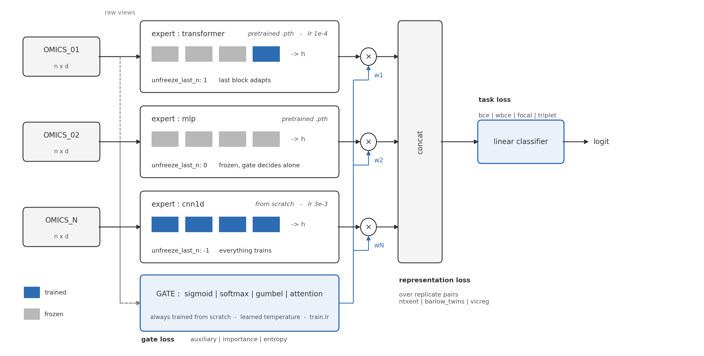
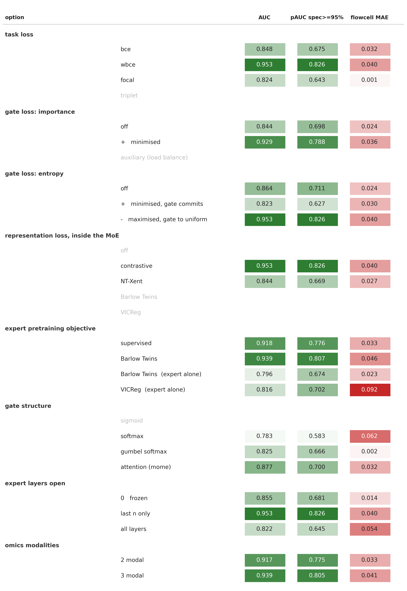
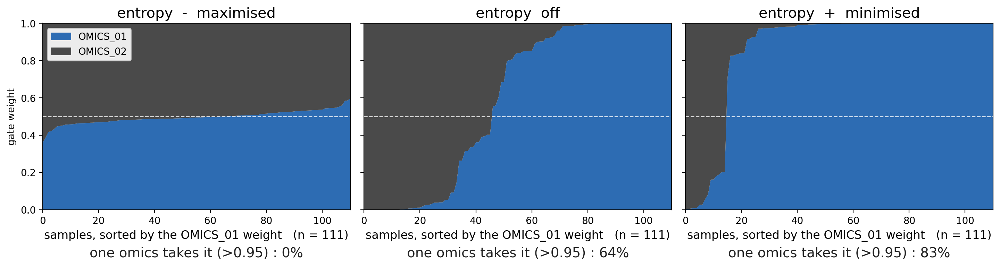
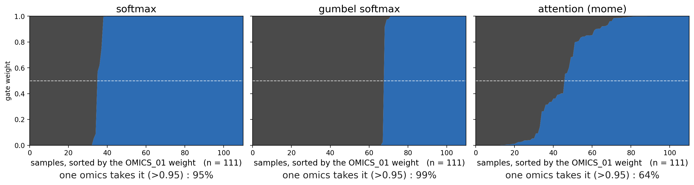
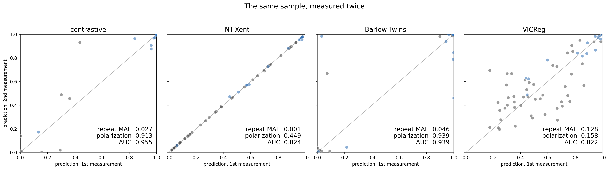

# MoE Tricks

Trials to use Mixture of Experts on multi-omic features.

**Objective: not only SOTA, but also Explainable.**

Omics = Dataset with Modality (in Biology)

One config file decides the whole model: how many omics views there are, what
each expert looks like, which gate structure routes them, and which losses are
attached where. Nothing in the code is tied to a particular assay - the views
are called `OMICS_01`, `OMICS_02`, ... and you add a third by adding two YAML
blocks.

---

## What you can combine




| axis | values | config key |
|---|---|---|
| views | any number, any width | `data.omics.*` |
| expert architecture | `mlp` · `cnn1d` · `transformer` | `model.experts.<view>.arch` |
| expert init | scratch · pretrained `.pth` | `model.experts.<view>.pretrained` |
| how much of a pretrained expert trains | `0` frozen · `n` last n modules · `-1` all | `model.experts.<view>.unfreeze_last_n` |
| gate structure | `sigmoid` · `softmax` · `gumbel` · `attention` | `model.gate.type` |
| task loss | `bce` · `wbce` · `focal` · `triplet` | `loss.task.name` |
| gate losses | `auxiliary` · `importance` · `entropy`, weighted | `loss.gate.*` |
| representation loss | `ntxent` · `barlow_twins` · `vicreg`, weighted | `loss.representation` |
| per-expert learning rate | one rate per view, or `expert_lr_scale: 0` to freeze all | `model.experts.<view>.lr` |

## Experiment









Any dotted path in that table can be handed to optuna instead of being fixed:

```yaml
optimize:
  enabled: true
  n_trials: 30
  space:
    model.gate.type: {type: categorical, choices: [sigmoid, softmax, gumbel, attention]}
    model.experts.OMICS_01.arch: {type: categorical, choices: [transformer, cnn1d]}
    model.experts.OMICS_01.unfreeze_last_n: {type: categorical, choices: [0, 1, 2, 3]}
    loss.representation.weight: {type: float, low: 0.0, high: 0.5, step: 0.05}
```

---

## Run

```bash
python run_moe.py configs/scratch.yaml           # experts + gate trained at once
python run_moe.py configs/pretrained_gate.yaml   # pretrained experts, gate only
python run_moe.py cfg.yaml --set train.epochs=50 --set model.gate.type=attention
python run_moe.py --selftest                     # whole pipeline on synthetic data
```

Both modes are the *same* code path - what separates them is whether
`model.experts.<view>.pretrained` is set.

| file | contents |
|---|---|
| `moe_core.py` | experts, the four gates, every loss, checkpoint loading, freeze/unfreeze |
| `moe_data.py` | reads N omics tables + meta into aligned views |
| `moe_train.py` | train loop, cross-validation, metrics, checkpoint bundles |
| `run_moe.py` | CLI: config -> CV -> (optuna) -> refit -> save |
| `configs/*.yaml` | the two starting points, every knob documented inline |

Each module runs its own self-check: `python moe_core.py`, `python moe_data.py`,
`python moe_train.py`, `python run_moe.py --selftest`.

### Data contract

One meta row = one modelled observation. Repeated measurements of the same
subject (two flowcell libraries, two aliquots) are two rows sharing
`subject_col`; they always travel together - same split, same CV fold, same
batch - and the representation losses pair them up. A view that only exists per
subject is broadcast onto both rows. Scoring averages the replicates back to one
value per subject.

---

## Consideration for loss as statistical approach

### [for gate]

The three gate terms are all **minimised** and all deliberately weak: at a scale
of ~1 they dwarf a task loss of ~0.1 and pin every sample at a uniform gate,
which looks like a working gate and is in fact a dead one.

**auxiliary loss** - the Switch-Transformer load balancer,
`N * sum_i f_i * P_i`, where `f_i` is the fraction of samples whose top expert
is `i` and `P_i` the mean gate probability of `i`. It is 1.0 at perfect balance.
Unlike the importance term it couples the *hard* assignment to the *soft*
probability, so it keeps pushing even when the mean gate already looks uniform.

**gate importance loss** - squared deviation of the batch-mean gate from
uniform. Pure anti-collapse and a weaker, smoother signal. With few experts and
one shared classifier there is no capacity problem to solve, so this is usually
the right term to start with.

**gate entropy loss** - mean per-sample entropy. Minimising it lets the gate
*commit* per sample (towards 0/1 routing) while importance/auxiliary keep the
global mix even. The two must be used together: entropy alone collapses to one
expert for everybody, importance alone pins every sample at 1/N. An earlier
version *maximised* entropy, which combined with importance held every sample at
0.5/0.5 - a gate that cannot say anything about a patient.

For the `sigmoid` gate the weights are not a distribution, so the entropy term
becomes the mean per-expert **binary** entropy and the balance terms read the
weights normalised to one.

### [for feature]

**triplet loss** - batch-hard triplet over the joint representation, using the
binary label as the identity: the hardest same-label pair is pulled together and
the hardest different-label pair pushed apart. It shapes the geometry rather
than the decision value, so it keeps a BCE term alongside (`bce_weight`) or the
classifier is free to drift out of calibration.

Class imbalance is handled either by the sampler (`balanced_sampler`, which
resamples *subjects* so replicates stay together) or by **wbce**, whose
`pos_weight` defaults to `n_neg / n_pos` of the training labels. Use one or the
other - both at once double-counts the correction.

### [for representation]

These act on repeated measurements of one subject (flowcell A vs B): the same
biology measured twice, so a representation that moves between A and B is
measuring the library, not the patient. All three are computed on the
gate-weighted joint representation and return exactly 0 when a batch holds no
replicate pair.

**NT-Xent** - contrastive: the replicate is the positive, every other sample in
the batch a negative. Needs negatives, so it fights the task loss when batches
are small; it also pulls apart two patients who genuinely look alike.

**Barlow Twins** - cross-correlation of the two replicate batches towards the
identity: diagonal 1 (invariant to the batch effect), off-diagonal 0
(non-redundant dimensions). No negatives, so batch size matters far less - a
real advantage on cohorts of ~100.

**VICReg** - invariance + variance + covariance, each with its own coefficient.
The variance hinge is the part the other two lack: it explicitly forbids
dimensional collapse instead of hoping the negatives prevent it, which is the
failure mode to expect when the two replicates are *too* similar.

Rule of thumb: start with Barlow Twins or VICReg when replicates are the only
structure you have, NT-Xent when the batch is large enough for negatives to
mean something.

---

## Consideration for gate structure

All four take the (standardised, LayerNormed) views and emit one weight per
expert, with a learned temperature.

**sigmoid** - one linear layer, an *independent* weight per expert. The weights
do not sum to 1, so experts can be on or off together: a soft ensemble, not a
routing decision. Use it when the views are complementary rather than
competing - nothing forces the model to spend a fixed budget of attention.

**softmax** - one linear layer, a simplex over the experts. The usual MoE: the
views compete, and the weight reads directly as "how much of this call came from
OMICS_01". That interpretability is the reason to prefer it when the gate itself
is the result you want to report.

**gumbel softmax** - softmax with Gumbel noise while training, plain softmax at
eval. Pushes towards a near-discrete choice without losing gradients. Worth it
when you believe one view is *right* per patient and the soft average is
blurring two mechanisms into one; the noise also regularises a gate that would
otherwise memorise a small cohort.

**attentioned gate** - per view a gated-tanh block (`tanh(Wx) * sigmoid(Vx)`,
the MoME gate), concatenated, then one linear layer and a softmax. The gate can
weigh *parts* of a view before deciding, so it survives a view whose relevant
signal is a handful of features drowned in thousands. Costs parameters, which on
a small cohort is exactly the risk.

### gate for input feature vs hidden dimension

**Currently implemented: input-feature gating.** The gate reads the raw views, so
the routing decision is a statement about the *data* ("this patient's OMICS_02 is
informative"), independent of how well each expert happens to be trained at that
moment. That is what makes the gate weight quotable as a result, and it is the
only option when an expert is a frozen black box.

**Hidden-dimension gating** - the gate reads the expert representations instead
(`h_i` rather than `x_i`) - is the alternative worth testing. It lets the gate
react to what an expert actually extracted, which is strictly more informative,
but it couples gate and expert training: an expert that starts badly gets
down-weighted, trains less, and stays bad. On a small cohort that feedback loop
is the thing to watch. *Not implemented yet*; it is a change of one argument at
`MoE.forward_with_rep` (feed `feats` to the gate instead of the normalised
inputs) plus the matching `expert_output_dims` in `MoEGate`.

A third option nobody should skip considering: **no gate at all** (plain
concatenation) as the baseline. If the gate does not beat it, the gate is
decoration.

---

## Consideration for expert (+ transfer learning)

Experts are built from scratch or loaded from a `.pth` - TorchScript, a pickled
module, or a `state_dict` bundle. A loaded expert can be kept frozen, partially
unfrozen, or fine-tuned whole.

### how many layers should be open / freeze

`unfreeze_last_n` counts **parameter-owning sub-modules from the output end**:

| value | effect | when |
|---|---|---|
| `0` | fully frozen; only gate + classifier learn | the expert was trained on far more data than this cohort has; you want the gate's contribution isolated |
| `1`–`2` | the head (and the last block) adapt | the representation transfers but the decision boundary does not - the usual case across sites/protocols |
| larger `n` | progressively deeper adaptation | the input distribution itself shifted (different assay, different depth) |
| `-1` | everything trains | enough data, or the pretrained weights are only an initialisation |

Three things the code enforces so the choice means what you think it means:

- a frozen expert is held in **eval mode**, so its dropout and BatchNorm running
  statistics do not keep moving while "only the gate learns";
- frozen parameters contribute **no optimiser group**, so weight decay cannot
  quietly shrink them;
- each expert keeps **its own learning rate** - a single shared rate cannot serve
  a transformer that wants ~3e-3 and an MLP that wants ~6e-4, and a tail being
  fine-tuned usually wants an order of magnitude less than the gate being
  trained from scratch.

`train.expert_lr_scale: 0` freezes every expert at once regardless of
`unfreeze_last_n` - the cheapest "is the gate doing anything?" ablation.

Warm-starting inside cross-validation is where leakage hides: an expert
pretrained on the full development set has already seen the held-out fold.
Either the pretrained weights come from outside the cohort entirely, or you need
fold-specific checkpoints. Nothing in the code can detect this for you.

---

## Consideration for explainability

The point of a gate is that it is readable. What a run already leaves behind:

- `pred.npz` - per-row **gate weights** for every development row
  (out-of-fold, `dev_gate_oof`) and every external row (`ext_gate`), next to the
  predictions and labels. Which view carried which patient is a table, not a
  guess.
- `history.tsv` - the per-epoch value of *every* loss component separately, so a
  gate that collapsed can be told apart from a gate that was never pushed.
- `expert_<view>.pth` / `moe_head.pth` - the parts saved independently, so an
  expert can be lifted out and probed on its own, or re-used as the
  `pretrained:` of the next run.
- the trial table (`trials_metrics.tsv`) carries the mean gate weight per view
  alongside the score, which is how you catch a model that scores well *because*
  the gate stopped routing.
