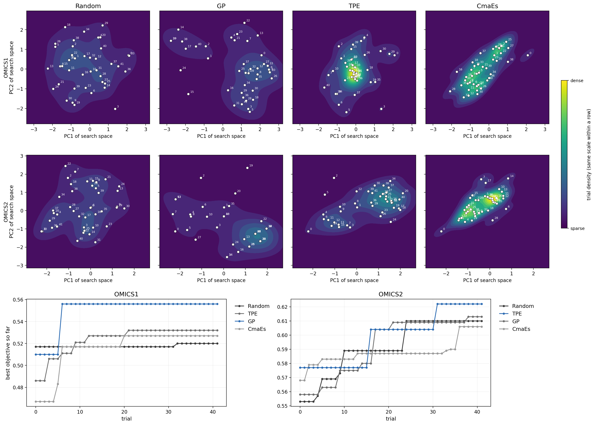
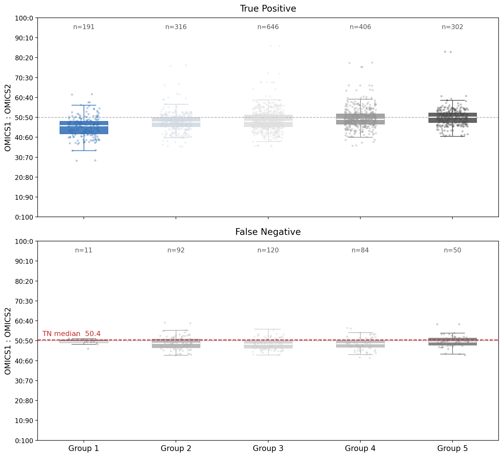

# MoE Tricks

Trials to use Mixture of Experts on multi-omic features.

**Objective: not only SOTA, but also Explainable.**

Omics = Dataset with Modality (in Biology)

One config file decides the whole model: how many omics views there are, what
each expert looks like, which gate structure routes them, and which losses are
attached where. Nothing in the code is tied to a particular assay - the views
are called `OMICS_01`, `OMICS_02`, ... and you add a third by adding two YAML
blocks.

---

## What you can combine


| axis | values | config key |
|---|---|---|
| views | any number, any width | `data.omics.*` |
| expert architecture | `mlp` · `cnn1d` · `transformer` | `model.experts.<view>.arch` |
| expert init | scratch · pretrained `.pth` | `model.experts.<view>.pretrained` |
| how much of a pretrained expert trains | `0` frozen · `n` last n modules · `-1` all | `model.experts.<view>.unfreeze_last_n` |
| gate structure | `sigmoid` · `softmax` · `gumbel` · `attention` | `model.gate.type` |
| task loss | `bce` · `wbce` · `focal` · `triplet` | `loss.task.name` |
| gate losses | `auxiliary` · `importance` · `entropy`, weighted | `loss.gate.*` |
| representation loss | `ntxent` · `barlow_twins` · `vicreg`, weighted | `loss.representation` |
| per-expert learning rate | one rate per view, or `expert_lr_scale: 0` to freeze all | `model.experts.<view>.lr` |

**Notation used below.** Sample $n$ of a batch of size $B$, view $i$ of $N$
views. $x_{ni}$ is the raw view, $h_{ni}$ the expert's representation,
$g_{ni}$ the gate weight, $p_n$ the predicted probability, $y_n$ the label.
The joint representation and the logit are

$$
z_n=\big[\,g_{n1}h_{n1}\;\Vert\;\cdots\;\Vert\;g_{nN}h_{nN}\,\big],\qquad
\text{logit}_n=w^\top z_n+b .
$$

## Experiment


Any dotted path in that table can be handed to optuna instead of being fixed:

```yaml
optimize:
  enabled: true
  n_trials: 30
  space:
    model.gate.type: {type: categorical, choices: [sigmoid, softmax, gumbel, attention]}
    model.experts.OMICS_01.arch: {type: categorical, choices: [transformer, cnn1d]}
    model.experts.OMICS_01.unfreeze_last_n: {type: categorical, choices: [0, 1, 2, 3]}
    loss.representation.weight: {type: float, low: 0.0, high: 0.5, step: 0.05}
```

---

## Run

```bash
python run_moe.py configs/scratch.yaml           # experts + gate trained at once
python run_moe.py configs/pretrained_gate.yaml   # pretrained experts, gate only
python run_moe.py cfg.yaml --set train.epochs=50 --set model.gate.type=attention
python run_moe.py --selftest                     # whole pipeline on synthetic data
```

Both modes are the *same* code path - what separates them is whether
`model.experts.<view>.pretrained` is set.

| file | contents |
|---|---|
| `moe_core.py` | experts, the four gates, every loss, checkpoint loading, freeze/unfreeze |
| `moe_data.py` | reads N omics tables + meta into aligned views |
| `moe_train.py` | train loop, cross-validation, metrics, checkpoint bundles |
| `run_moe.py` | CLI: config -> CV -> (optuna) -> refit -> save |
| `configs/*.yaml` | the two starting points, every knob documented inline |

Each module runs its own self-check: `python moe_core.py`, `python moe_data.py`,
`python moe_train.py`, `python run_moe.py --selftest`.

### Data contract

One meta row = one observation. The same subject measured twice gives two rows
sharing `subject_col`; they stay together in the same split, fold and batch, and
the representation losses pair them. A view that exists only per subject is
copied onto both rows. Scores are averaged back to one value per subject.

---

## Consideration for loss as statistical approach

$$
\mathcal{L}=\mathcal{L}_{\text{task}}
+\lambda_{\text{aux}}\mathcal{L}_{\text{aux}}
+\lambda_{\text{imp}}\mathcal{L}_{\text{imp}}
+\lambda_{\text{ent}}\mathcal{L}_{\text{ent}}
+\lambda_{\text{rep}}\mathcal{L}_{\text{rep}}
$$

### [for gate]

All three are **minimised**, and all three must stay small: at $\lambda\approx1$
they are ten times the task loss and freeze every sample at $1/N$.


Mean weight of view $i$: $P_i=\tfrac1B\sum_n g_{ni}$. Share of samples routed
to $i$: $f_i=\tfrac1B\sum_n\mathbf{1}[\arg\max_j g_{nj}=i]$.

| term | formula | what it buys |
|---|---|---|
| `auxiliary` | $N\sum_i f_iP_i\ \ (\ge1)$ | load balance; couples hard count to soft weight, so it keeps pushing |
| `importance` | $\sum_i\left(P_i-\tfrac1N\right)^2$ | anti-collapse, smoother and weaker - start here |
| `entropy` | $-\tfrac1B\sum_n\sum_i g_{ni}\log g_{ni}$ | lets each sample commit to one view |

Use `entropy` **with** a balance term: alone it sends everyone to one view, while
`importance` alone pins everyone at $1/N$. Maximising entropy (a minus sign in
front) is what froze the left panel at 50:50. For the `sigmoid` gate the weights
are not a distribution, so entropy becomes per-view **binary** entropy and the
balance terms use $g_{ni}/\sum_j g_{nj}$.

### [for feature]

| loss | formula | note |
|---|---|---|
| `bce` / `wbce` | $-\tfrac1B\sum_n\left[c\,y_n\log p_n+(1-y_n)\log(1-p_n)\right]$ | `wbce` sets $c=n_{\text{neg}}/n_{\text{pos}}$ |
| `focal` | $-\tfrac1B\sum_n\alpha_t(1-p_t)^{\gamma}\log p_t$ | $p_t$ = probability of the true class; easy cases fade |
| `triplet` | $\tfrac1B\sum_n\max(0,\ \max_{y_j=y_n}\lVert z_n-z_j\rVert-\min_{y_j\neq y_n}\lVert z_n-z_j\rVert+m)$ | shapes distances, not probability - keep a BCE term beside it |

Imbalance: `balanced_sampler` **or** `wbce`, not both.

### [for representation]

The same subject measured twice: whatever moves between the two is the assay,
not the patient. All three act on $z_n$, and are $0$ when a batch has no pair.
$z^A,z^B$ are the two measurements.


| loss | formula | one line |
|---|---|---|
| `ntxent` | $-\log\dfrac{\exp(s(z^A,z^B)/\tau)}{\sum_{m\neq A}\exp(s(z^A,z_m)/\tau)}$ | needs negatives, so small batches hurt |
| `barlow_twins` | $\sum_i(1-C_{ii})^2+\lambda\sum_{i\neq j}C_{ij}^2$ | drives the cross-correlation $C$ to $I$; no negatives, fine at $n\sim100$ |
| `vicreg` | $\alpha\lVert z^A-z^B\rVert^2+\beta\sum_k\max(0,1-\sqrt{\mathrm{Var}_k+\epsilon})+\gamma\sum_{k\neq l}\mathrm{Cov}_{kl}^2$ | the variance hinge pays it to stay spread out, so it resists collapse |

Start with `barlow_twins` or `vicreg` when replicates are all the structure you
have; `ntxent` once the batch is large enough for negatives to mean something.

---

## Consideration for gate structure

All four read the standardised, LayerNormed views and emit one weight per view.
With $u_n=W[x_{n1}\Vert\cdots\Vert x_{nN}]+b$ and a learned temperature
$\tau=\mathrm{softplus}(\theta)$:


| gate | weight | reads as |
|---|---|---|
| `sigmoid` | $\sigma(u_{ni}/\tau)$ | independent switches, $\sum_i g_{ni}\neq1$ - a soft ensemble |
| `softmax` | $\mathrm{softmax}(u_n/\tau)$ | a share of 100% - quotes cleanly |
| `gumbel` | $\mathrm{softmax}((u_n+\varepsilon)/\tau)$ with $\varepsilon\sim\mathrm{Gumbel}$, train only | a near-discrete pick |
| `attention` | $c_{ni}=\tanh(W_ix_{ni})\odot\sigma(V_ix_{ni})$, then softmax of $W_c[c_{n1}\Vert\cdots]$ | weighs parts of a view first; costs parameters |

Pick by the claim: `softmax` if the weight is the result, `gumbel` if one view
should win per patient, `sigmoid` if views complement rather than compete,
`attention` if a view is mostly noise.

### gate for input feature vs hidden dimension

**Implemented:** $g_n=\text{gate}(x_n)$ - the routing describes the *data*, not
the training state, so the weight is quotable and works with a frozen expert.

**Not implemented:** $g_n=\text{gate}(h_n)$ - more informative, but gate and
expert then train each other: a weak expert is down-weighted, trains less, stays
weak. (One change in `MoE.forward_with_rep` plus `expert_output_dims`.)

Keep **no gate** (plain concatenation) as the baseline; if the gate does not beat
it, the gate is decoration.

---

### Consideration for search space difference



Four ways to pick the next trial $x^{(t)}$ from the search space $\mathcal{X}$,
given the trials already scored, $\mathcal{D}=\{(x^{(s)},y^{(s)})\}_{s<t}$:

| sampler | samples from | in one line |
|---|---|---|
| `Random` | $\mathrm{Uniform}(\mathcal{X})$, ignores $\mathcal{D}$ | no model - even cover, never zooms in |
| `TPE` | $\ell(x)/g(x)$ large, with $\ell=p(x\mid y>y^\ast)$, $g=p(x\mid y\le y^\ast)$ | a density ratio, not a surface - concentrates fast |
| `GP` | $\arg\max_x\mathbb{E}[\max(0,f(x)-f^\ast)]$ under $f\sim\mathcal{GP}(\mu,k)$ | a surface with error bars - pays to visit unseen corners |
| `CmaEs` | $\mathcal{N}(m_t,\sigma_t^2C_t)$, $m_t,C_t$ from the best trials | an ellipse walking downhill - blind outside it |

The panels show it: `Random` fills the box, `TPE` collapses onto one peak, `GP`
keeps probing edges, `CmaEs` draws one elongated cloud. Best objective: `GP` on
OMICS1, `TPE` on OMICS2 - 42 trials is too few to call a winner.

---

## Consideration for expert (+ transfer learning)

An expert is built from scratch or loaded from a `.pth`, then frozen, opened
partly, or fine-tuned whole. `unfreeze_last_n` counts parameter-owning
sub-modules from the output end:

| value | trains | use when |
|---|---|---|
| `0` | gate + classifier only | the expert saw far more data than this cohort |
| `1`–`2` | head, last block | representation transfers, decision boundary does not |
| larger `n` | deeper | the input distribution itself shifted |
| `-1` | everything | enough data, or the weights are just an init |

A frozen expert stays in eval mode and gets no optimiser group, so its BatchNorm
statistics and weights really do not move. Each expert keeps its own learning
rate; `train.expert_lr_scale: 0` freezes them all at once.

**Leakage:** an expert pretrained on the whole development set has already seen
the held-out fold. Pretrain outside the cohort or keep fold-specific checkpoints.

---

## Consideration for explainability

A gate is worth having only if it is readable. Every run leaves:



| file | what it answers |
|---|---|
| `pred.npz` | per-row gate weights, out-of-fold and external - which view carried which patient |
| `history.tsv` | every loss component per epoch - a gate that collapsed vs one never pushed |
| `expert_<view>.pth`, `moe_head.pth` | probe one expert alone, or re-use it as the next `pretrained:` |
| `trials_metrics.tsv` | mean gate weight beside the score - catches a model that wins *because* the gate stopped routing |
